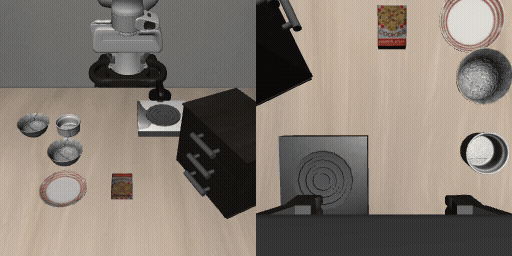
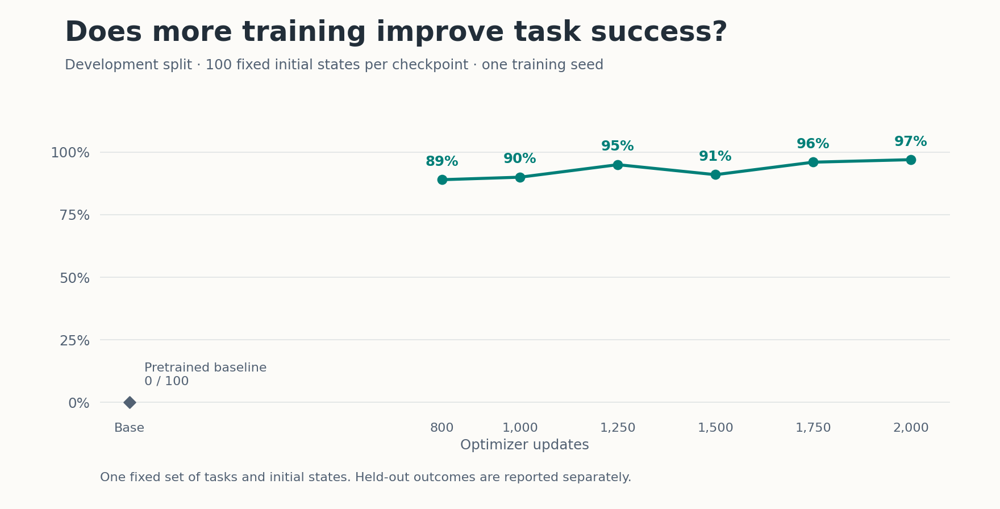

<p align="center">
  
</p>

<p align="center">
  <a href="README_CN.md">简体中文</a> ·
  <a href="#see-the-policy-in-action">Demos</a> ·
  <a href="#results">Results</a> ·
  <a href="docs/experiment.md">Experiment</a> ·
  <a href="docs/reproduce.md">Reproduce the analysis</a>
</p>

**Can one RTX A5000 turn a pretrained vision-language-action policy into a useful LIBERO controller? How much changes between checkpoints?**

This project follows one **π0.5 all-linear LoRA fine-tuning run** from the official `pi05_base` weights through 2,000 optimizer updates. Six checkpoints are evaluated on identical initial states, so improvements can be inspected at the level of individual robot episodes.

The 2,000-update checkpoint reaches **97/100 development successes**. The first completed held-out evaluation, at 800 updates, reaches **346/400 (86.5%)**. The remaining held-out evaluations are pending in this published snapshot.

## See the policy in action

The same 800-update policy, the same task, two different held-out initial states. Each recording shows the external and wrist camera views.

> **Instruction** · Pick up the black bowl between the plate and the ramekin and place it on the plate.

<table>
  <tr>
    <th width="50%">Successful episode · initial state 02</th>
    <th width="50%">Unsuccessful episode · initial state 16</th>
  </tr>
  <tr>
    <td><a href="assets/demos/step800-task00-init02.mp4"></a></td>
    <td><a href="assets/demos/step800-task00-init16.mp4"></a></td>
  </tr>
  <tr>
    <td>Success predicate reached in <b>78</b> policy steps.</td>
    <td>Success predicate unmet at the <b>220</b>-step limit.</td>
  </tr>
</table>

Previews play at approximately original speed. Click a preview for its original MP4. These are qualitative examples selected by a fixed rule, not an estimate of success rate. [More footage and episode provenance →](docs/demos.md)

## What this project builds

- **A constrained fine-tuning experiment.** Frozen pretrained weights, trainable LoRA adapters, and an effective batch of 256 on one GPU.
- **A controlled checkpoint comparison.** Six fixed checkpoints, shared initial states, separate development and held-out evaluations.
- **An inspectable evidence trail.** Completed episode outcomes, per-task counts, versioned settings, real recordings, and scripts that rebuild the analysis.


The training data covers **40 tasks**. Closed-loop evaluation covers **10 LIBERO-Spatial tasks**. The 85 offline validation demonstrations and the 400 held-out simulation episodes serve different purposes. [Full protocol →](docs/experiment.md)

## Results

### Checkpoint trajectory



| Policy | Development · 100 episodes | Held-out · 400 episodes |
|:--|--:|--:|
| Pretrained `pi05_base` | 0 / 100 | — |
| 800 updates | 89 / 100 | **346 / 400 · 86.5%** |
| 1,000 updates | 90 / 100 | Pending |
| 1,250 updates | 95 / 100 | Pending |
| 1,500 updates | 91 / 100 | Pending |
| 1,750 updates | 96 / 100 | Pending |
| 2,000 updates | **97 / 100** | Pending |

**Snapshot · November 16, 2026, 13:56 CST.** Only complete evaluation groups are published. The final held-out comparison covers all six checkpoints on the same 400 initial states. [CSV](results/per_task.csv) · [Episode records](results/episodes.csv) · [Provenance](results/provenance.json)

### Look beyond the average


Progress varies by task. For example, task 09 changes from 9/10 at 1,250 updates to 6/10 at 1,500, then 10/10 at 2,000. The overall curve alone hides this variation.


The 800-update held-out result ranges from **27/40 to 40/40** across tasks. A new initial state is held out; the task family itself is shared with training.

### Why pair individual episodes?


The change from 96% to 97% consists of **four gains and three losses** on the same initial states. This is a descriptive development-set comparison. The final 1,750 vs 2,000 comparison will use the shared held-out episodes. [How to read the results →](docs/results.md)

## Run the analysis locally

The evidence checks and paired comparison use only Python's standard library.

```sh
git clone https://github.com/chaoshengsc/pi05-libero-finetuning.git
cd pi05-libero-finetuning
python scripts/analyze_results.py
python scripts/analyze_results.py --pair 1750 2000 --split development
```

To rebuild the figures, install [the visualization dependency](requirements-viz.txt) and run `python scripts/plot_results.py`. The data validator rejects duplicate episodes, incomplete splits, and mismatched initial states. [Commands and expected outputs →](docs/reproduce.md)

## Repository guide

| Path | What to find |
|:--|:--|
| [`configs/`](configs/) | Recorded training settings and the frozen evaluation-state partition |
| [`results/`](results/README.md) | 1,100 episode outcomes, per-task aggregates, source hashes |
| [`assets/demos/`](docs/demos.md) | Original simulation recordings, preview GIFs, selection rule |
| [`scripts/`](scripts/) | Evidence validation, paired comparison, figure generation |
| [`docs/experiment.md`](docs/experiment.md) | Data, LoRA settings, inference loop, version pins |
| [`docs/results.md`](docs/results.md) | Findings, interpretation, remaining questions |

This release supports **reproducing the published analysis**. Model weights and the full training/evaluation launcher are not distributed here. Results describe one training seed in simulation; the held-out ranking is unfinished. The 800-update held-out run spans a kernel/driver update, recorded in the [experiment notes](docs/experiment.md#runtime-history).

## Built on

[OpenPI](https://github.com/Physical-Intelligence/openpi) provides the pretrained policy and model implementation. [LIBERO](https://github.com/Lifelong-Robot-Learning/LIBERO) provides the simulation benchmark. Demonstrations come from [physical-intelligence/libero](https://huggingface.co/datasets/physical-intelligence/libero/tree/9dfa69510ea9e1613fc54112bc706444b686a231). This is an independent fine-tuning study.
