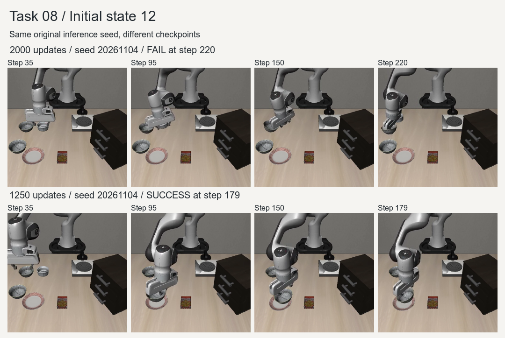

# LoRA Fine-Tuning of π0.5 on LIBERO

Single-GPU training, paired evaluation, and failure analysis

[简体中文](README_CN.md) · [Protocol](docs/experiment.md) · [Supplementary results](docs/results.md) · [Data](results/README.md) · [Reproduction](docs/reproduce.md)

## Abstract

We adapt the official `pi05_base` policy with all-linear LoRA for 2,000 optimizer updates on one RTX A5000. On 400 fixed LIBERO-Spatial initial states, the matched step-zero baseline (A0) succeeds in 0/400 episodes and the 2,000-update checkpoint in **382/400 (95.50%)**. Across 399 pairs with identical first observations, the change is **+95.50 percentage points** (task-weighted 95% paired bootstrap interval [93.50, 97.25]). The 1,250-update checkpoint has the highest observed score under the original inference seed (389/400). Its mean lead over 2,000 under two additional inference seeds is 1.25 points (95% interval [−0.50, 2.875]). Among the 18 original endpoint failures, 16 succeed under at least one additional seed.

## Experimental setup


**Figure 1. Experimental design.** (a) One training run produces six checkpoints. (b) Each checkpoint is evaluated on the same development and held-out task–initial-state pairs. The two evaluation partitions contain disjoint initial states of the same ten tasks. [PDF](assets/experiment-design.pdf) · [SVG](assets/experiment-design.svg)

**Table 1. Training and evaluation configuration.**

| Component | Specification |
|:--|:--|
| Initialization | Official OpenPI `pi05_base` |
| Adaptation | Frozen base; all-linear LoRA, rank 64, alpha 32 |
| Demonstrations | 40 tasks; 1,608 training and 85 offline-validation episodes |
| Optimization | Effective batch 256 (8 × 32); seed 0; 2,000 updates |
| Hardware | One NVIDIA RTX A5000 |
| Development | 10 LIBERO-Spatial tasks × 10 initial states = 100 episodes |
| Held-out | The same 10 tasks × 40 other initial states = 400 episodes |
| Outcome | Native simulator task-success predicate; 220-step limit |

The demonstration split and the simulation initial-state partition serve different purposes. Normalization is fitted on training demonstrations only. Within each evaluation split, every checkpoint uses identical initial states and the recorded sampling procedure. Full settings, version pins, and runtime history are documented in the [protocol](docs/experiment.md).

## Results


**Figure 2. Closed-loop success under inference seed 20261104.** (a) Development results for the six trained checkpoints (100 episodes each, axis starts at 80%). (b) Held-out results for A0 and all six checkpoints (400 episodes each). Bar labels show percentages. [PDF](assets/evaluation-results.pdf) · [SVG](assets/evaluation-results.svg)

**Table 2. Success counts on fixed initial states.** Bold marks each split's highest observed score. A0 is the official starting policy evaluated at step zero under the same adapter structure, input pipeline and training-derived normalization.

| Checkpoint | Development (n = 100) | Held-out (n = 400) |
|:--|--:|--:|
| A0 · step zero | 0 / 100 | 0 / 400 |
| 800 | 89 / 100 | 346 / 400 |
| 1,000 | 90 / 100 | 364 / 400 |
| 1,250 | 95 / 100 | **389 / 400** |
| 1,500 | 91 / 100 | 380 / 400 |
| 1,750 | 96 / 100 | 379 / 400 |
| 2,000 | **97 / 100** | 382 / 400 |

The strict A0 comparison has 381 successes unique to 2,000 and 18 shared failures. One pair (task 01, state 34) has a historical first-observation mismatch. The full 400-state sensitivity estimate is also +95.50 points. The 2,000-update endpoint leads 1,750 by 0.75 points on the original held-out evaluation (95% interval [−2.00, 3.50]). [Paired and per-task results](docs/results.md)

## Sensitivity to inference randomness

Each seed uses the same 400 held-out initial states. Intervals resample matched initial states within tasks. The two additional seeds leave the checkpoint comparison unresolved at the aggregate level.

| Inference seed | 1,250 updates | 2,000 updates | Difference (pp) | 95% paired interval (pp) |
|:--|--:|--:|--:|--:|
| 20261104 | 389 / 400 | 382 / 400 | +1.75 | [−0.50, 4.00] |
| 20261118 | 395 / 400 | 385 / 400 | +2.50 | [0.50, 4.50] |
| 20261119 | 379 / 400 | 379 / 400 | 0.00 | [−2.75, 2.75] |

## Failure analysis

At 2,000 updates, failures under the original seed occur in the top-drawer (11/40), ramekin (1/40), and plate-adjacent (6/40) tasks. Of those 18 states, 11 succeed with both additional seeds, 5 with one, and 2 with neither. The additional seeds also turn 11 and 16 original successes into failures, yielding net changes of +3 and −3 episodes. [All 18 cases](docs/results.md#endpoint-failure-analysis)



**Figure 3. Task 08, state 12.** At 2,000 updates, the arm works around the rear containers and the target bowl remains beside the plate at step 220. The 1,250-update policy places the target bowl on the plate and meets the success predicate at step 179. The recorded first observation and inference seed match. The examples were selected after evaluation to illustrate behavior.

Watch in browser: [04/00 · Seed-dependent drawer retrieval](https://cdn.jsdelivr.net/gh/chaoshengsc/pi05-libero-finetuning@70cf7dc0754567b5b425e05f74cc18f68f3f52f1/assets/failures/task04-00-comparison.mp4) · [04/45 · Repeated drawer failure](https://cdn.jsdelivr.net/gh/chaoshengsc/pi05-libero-finetuning@70cf7dc0754567b5b425e05f74cc18f68f3f52f1/assets/failures/task04-45-comparison.mp4) · [08/12 · Checkpoint contrast](https://cdn.jsdelivr.net/gh/chaoshengsc/pi05-libero-finetuning@70cf7dc0754567b5b425e05f74cc18f68f3f52f1/assets/failures/task08-12-comparison.mp4). [Full captions and frames](docs/demos.md#paired-failure-comparisons)

## Reproducibility

The November 18 snapshot contains **5,100 scored outcomes**, including 3,500 under the original inference seed and 1,600 under the two additional seeds. The held-out comparisons reuse the same 400 initial states. Validation and statistics require only Python's standard library.

```sh
git clone https://github.com/chaoshengsc/pi05-libero-finetuning.git
cd pi05-libero-finetuning
python scripts/analyze_results.py
python scripts/analyze_results.py --report
```

| Material | Location |
|:--|:--|
| Training settings and data partitions | [`configs/`](configs/) |
| Episode-level outcomes and aggregates | [`results/`](results/README.md) |
| Recordings and provenance | [`assets/demos/`](docs/demos.md) |
| Validation and figure-generation scripts | [`scripts/`](scripts/) |
| Environment and reproduction commands | [`docs/reproduce.md`](docs/reproduce.md) |

Figures are generated from validated records and exported as PNG, SVG, and PDF. This release supports reproduction of the published analysis. Model weights and the complete training/evaluation launcher are not distributed here.

## Limitations

Results describe one training seed and ten known LIBERO-Spatial tasks in simulation. The 1,250-update candidate was identified after inspecting the original held-out results. Inference seed repeats reuse the initial states, and the bootstrap intervals condition on the tested tasks, weights and inference seeds. The 800-update held-out group spans a kernel and driver update (352 episodes before the restart, 48 after). [Protocol and runtime history](docs/experiment.md)

## Upstream resources

- [OpenPI](https://github.com/Physical-Intelligence/openpi) — pretrained policy and model implementation.
- [LIBERO](https://github.com/Lifelong-Robot-Learning/LIBERO) — simulation tasks and initial states.
- [physical-intelligence/libero](https://huggingface.co/datasets/physical-intelligence/libero/tree/9dfa69510ea9e1613fc54112bc706444b686a231) — demonstration dataset.

This repository documents an independent fine-tuning experiment.
