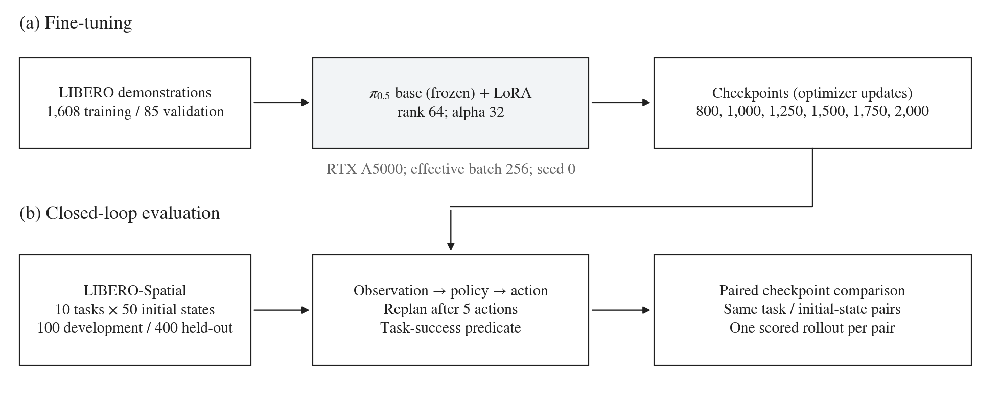
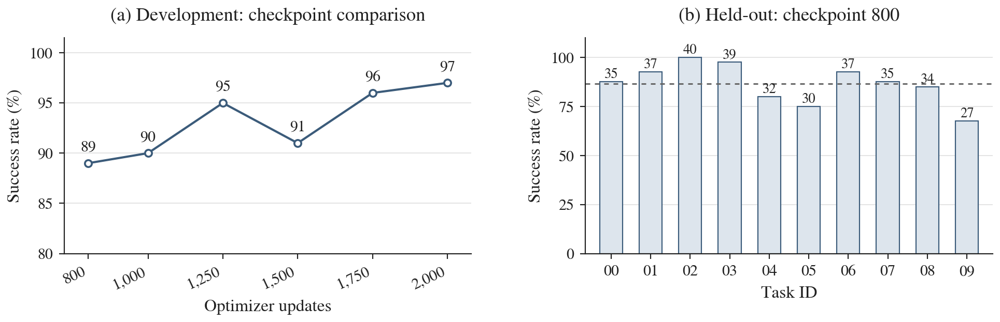
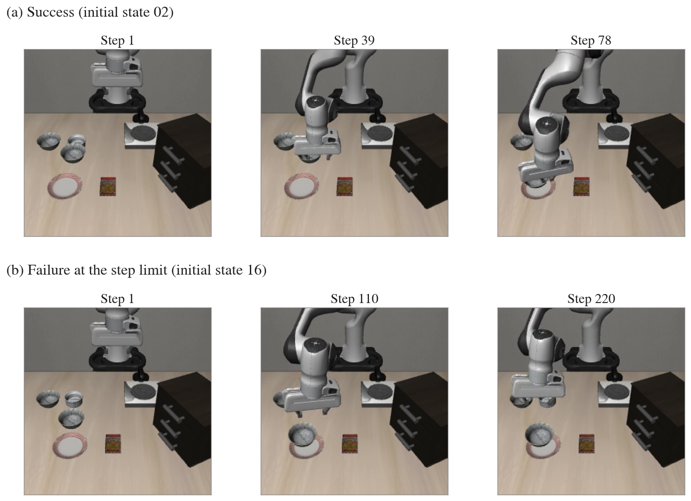

# LoRA Fine-Tuning of π0.5 on LIBERO

Single-GPU training and paired checkpoint evaluation

[简体中文](README_CN.md) · [Protocol](docs/experiment.md) · [Supplementary results](docs/results.md) · [Data](results/README.md) · [Reproduction](docs/reproduce.md)

## Abstract

We study parameter-efficient adaptation of the official `pi05_base` policy to LIBERO using one RTX A5000. A single all-linear LoRA run is trained for 2,000 optimizer updates, retaining six checkpoints. Closed-loop evaluation uses fixed task–initial-state pairs, with disjoint development and held-out partitions. Development success increases from 89/100 at 800 updates to 97/100 at 2,000 updates; the pretrained baseline scores 0/100 under the same development protocol. The first complete held-out evaluation, at 800 updates, yields 346/400 successes (86.5%). This repository provides the experimental specification, episode-level outcomes, recordings, and analysis code.

Results below correspond to the **November 16, 2026, 13:56 CST** snapshot. The remaining held-out groups are not included until complete.

## Experimental setup



**Figure 1. Experimental design.** (a) One training run produces six checkpoints. (b) Each checkpoint is evaluated on the same development and held-out task–initial-state pairs. The two evaluation partitions contain disjoint initial states of the same ten tasks. [PDF](assets/experiment-design.pdf) · [SVG](assets/experiment-design.svg)

**Table 1. Training and evaluation configuration.**

| Component | Specification |
|:--|:--|
| Initialization | Official OpenPI `pi05_base` |
| Adaptation | Frozen base; all-linear LoRA, rank 64, alpha 32 |
| Demonstrations | 40 tasks; 1,608 training and 85 offline-validation episodes |
| Optimization | Effective batch 256 (8 × 32); seed 0; 2,000 updates |
| Hardware | One NVIDIA RTX A5000 |
| Development | 10 LIBERO-Spatial tasks × 10 initial states = 100 episodes |
| Held-out | The same 10 tasks × 40 other initial states = 400 episodes |
| Outcome | Native simulator task-success predicate; 220-step limit |

The demonstration split and the simulation initial-state partition serve different purposes. Normalization is fitted on training demonstrations only. Within each evaluation split, every checkpoint uses identical initial states and the recorded sampling procedure. Full settings, version pins, and runtime history are documented in the [protocol](docs/experiment.md).

## Results



**Figure 2. Closed-loop task success.** (a) Development evaluation, 100 episodes per checkpoint. The vertical axis is truncated at 80%; the pretrained baseline (0/100) is reported in Table 2. (b) Held-out evaluation of checkpoint 800, 40 episodes per task. Labels above bars denote success counts; the dashed line denotes the overall rate of 86.5%. Task definitions are listed in the [data dictionary](results/README.md#task-dictionary). [PDF](assets/evaluation-results.pdf) · [SVG](assets/evaluation-results.svg)

**Table 2. Success counts on fixed initial states.** All reported groups are complete. Bold denotes the highest observed development score among the six trained checkpoints.

| Checkpoint | Development (n = 100) | Held-out (n = 400) |
|:--|--:|--:|
| Pretrained `pi05_base` | 0 / 100 | — |
| 800 | 89 / 100 | 346 / 400 |
| 1,000 | 90 / 100 | Pending |
| 1,250 | 95 / 100 | Pending |
| 1,500 | 91 / 100 | Pending |
| 1,750 | 96 / 100 | Pending |
| 2,000 | **97 / 100** | Pending |

Development performance is non-monotonic across checkpoints. Comparing 1,750 and 2,000 updates on paired development episodes yields 93 shared successes, 3 successes unique to 1,750, and 4 unique to 2,000. The net difference is one percentage point. This descriptive comparison does not establish a held-out advantage. Per-task scores and the paired contingency table are provided in the [supplementary results](docs/results.md).

## Qualitative results



**Figure 3. Recorded policy rollouts.** Task 00, checkpoint 800. (a) Initial state 02 reaches the success predicate in 78 policy steps. (b) Initial state 16 remains unsuccessful at the 220-step limit. Each row shows its first, middle, and final recorded frames from the external camera; the rows use different initial states and time indices. These selected examples illustrate behavior and do not estimate success rate. [PDF](assets/qualitative-rollouts.pdf) · [Recordings and selection rule](docs/demos.md)

[Successful episode (MP4)](assets/demos/step800-task00-init02.mp4) · [Unsuccessful episode (MP4)](assets/demos/step800-task00-init16.mp4) · [Additional task example](docs/demos.md#task-09--on-the-wooden-cabinet)

## Reproducibility

The public snapshot contains 1,100 episode outcomes. Validation and paired counts require only Python's standard library.

```sh
git clone https://github.com/chaoshengsc/pi05-libero-finetuning.git
cd pi05-libero-finetuning
python scripts/analyze_results.py
python scripts/analyze_results.py --pair 1750 2000 --split development
```

| Material | Location |
|:--|:--|
| Training settings and data partitions | [`configs/`](configs/) |
| Episode-level outcomes and aggregates | [`results/`](results/README.md) |
| Recordings and provenance | [`assets/demos/`](docs/demos.md) |
| Validation and figure-generation scripts | [`scripts/`](scripts/) |
| Environment and reproduction commands | [`docs/reproduce.md`](docs/reproduce.md) |

Figures are generated from validated records and exported as PNG, SVG, and PDF. This release supports reproduction of the published analysis. Model weights and the complete training/evaluation launcher are not distributed here.

## Limitations

Results describe one training seed, known LIBERO-Spatial tasks, and simulation. Held-out initial states do not constitute unseen-task or real-robot evaluation. The six-checkpoint held-out ranking is incomplete in this snapshot. The 800-update held-out group spans a kernel/driver update, with 352 episodes completed before the restart and 48 afterward; see [runtime history](docs/experiment.md#runtime-history).

## Upstream resources

- [OpenPI](https://github.com/Physical-Intelligence/openpi) — pretrained policy and model implementation.
- [LIBERO](https://github.com/Lifelong-Robot-Learning/LIBERO) — simulation tasks and initial states.
- [physical-intelligence/libero](https://huggingface.co/datasets/physical-intelligence/libero/tree/9dfa69510ea9e1613fc54112bc706444b686a231) — demonstration dataset.

This repository documents an independent fine-tuning experiment.
