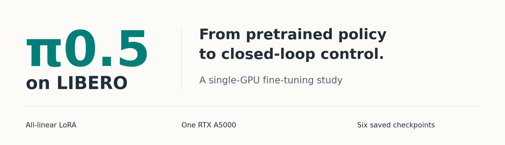
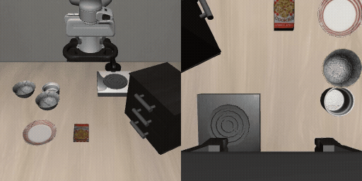
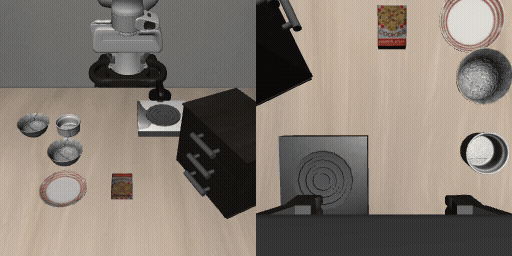
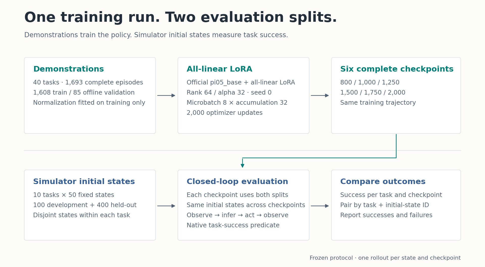
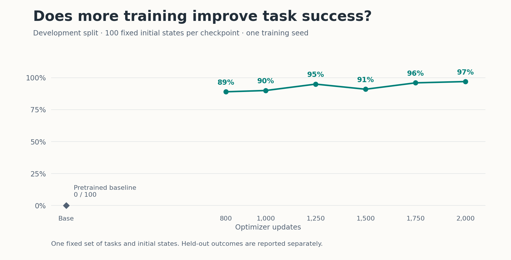
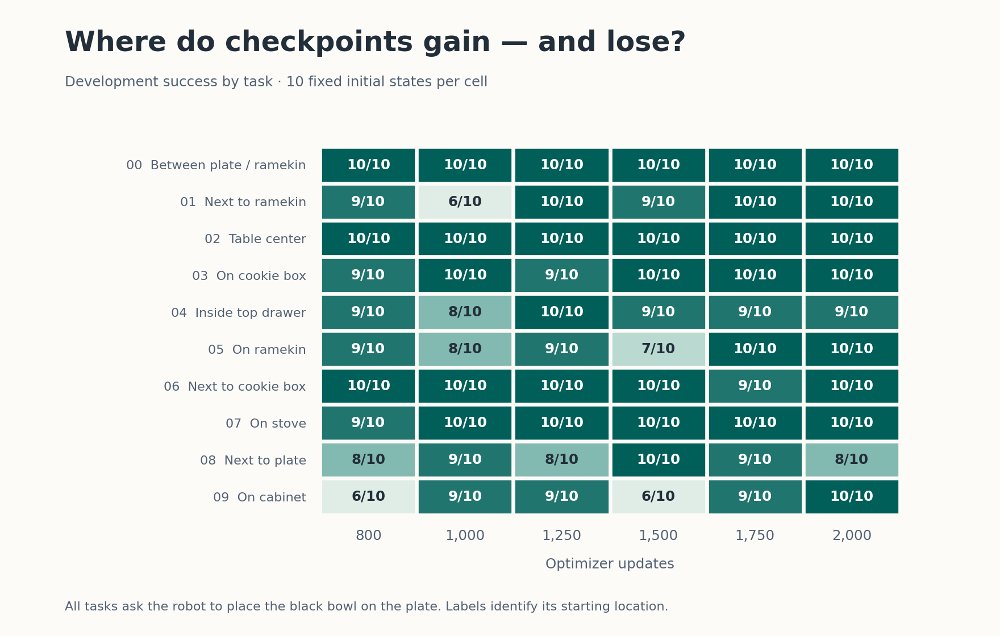
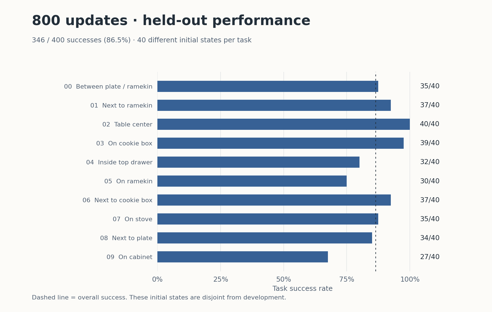
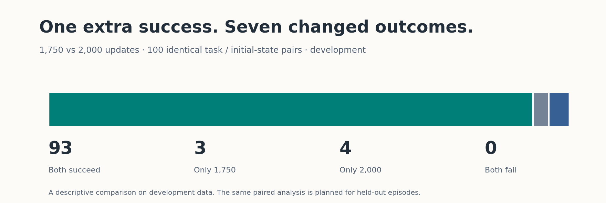

<p align="center">
  
</p>

<p align="center">
  <a href="README.md">English</a> ·
  <a href="#先看机器人实际表现">动作演示</a> ·
  <a href="#实验结果">实验结果</a> ·
  <a href="docs/experiment.md">实验协议</a> ·
  <a href="docs/reproduce.md">复现分析</a>
</p>

**一张 RTX A5000，能否把预训练 VLA 策略微调成可用的 LIBERO 控制器？多训练一些，究竟改善了哪些回合？**

本项目从官方 `pi05_base` 权重出发，完成一轮 **π0.5 全线性层 LoRA 微调**，训练至 2,000 次参数更新。沿途保存六个固定检查点，再用同一批仿真初态逐一评测，把训练过程和实际任务表现联系起来。

2,000 步检查点在开发集成功 **97/100** 次。首个完成的正式留出评测来自 800 步检查点，成功 **346/400（86.5%）**。本次公开快照尚未包含其余检查点的完整留出成绩。

## 先看机器人实际表现

同一个 800 步模型、同一个任务，两个不同的留出初态。每段录像并列展示外部相机与腕部相机画面。

> **任务指令** · 拿起盘子与小碗之间的黑碗，将它放到盘子上。

<table>
  <tr>
    <th width="50%">成功回合 · 初态 02</th>
    <th width="50%">未成功回合 · 初态 16</th>
  </tr>
  <tr>
    <td><a href="assets/demos/step800-task00-init02.mp4"></a></td>
    <td><a href="assets/demos/step800-task00-init16.mp4"></a></td>
  </tr>
  <tr>
    <td>第 <b>78</b> 个策略动作步满足成功条件。</td>
    <td>到 <b>220</b> 步上限仍未满足成功条件。</td>
  </tr>
</table>

预览以约原速播放，点击可打开原始 MP4。演示按固定规则选取，用来观察行为，成功率由全部评测回合计算。[更多录像与来源 →](docs/demos.md)

## 这个项目做了什么

- **单卡微调。** 冻结预训练权重，训练 LoRA 适配器，通过梯度累积实现有效批大小 256。
- **固定条件下比较检查点。** 六个节点使用相同初态，开发集与正式留出集分开，比较落实到具体任务和回合。
- **保留可核查的实验材料。** 公开完整回合的结果、逐任务统计、版本与参数、真实录像，以及可重建分析的脚本。



训练数据覆盖 **40 个任务**，闭环评测覆盖 **10 个 LIBERO-Spatial 任务**。85 条离线验证示范与 400 个留出仿真回合的用途不同。[完整实验协议 →](docs/experiment.md)

## 实验结果

### 沿训练过程观察任务成功率



| 策略 | 开发评测 · 100 回合 | 留出评测 · 400 回合 |
|:--|--:|--:|
| 预训练 `pi05_base` | 0 / 100 | — |
| 800 步 | 89 / 100 | **346 / 400 · 86.5%** |
| 1,000 步 | 90 / 100 | 待完整结果 |
| 1,250 步 | 95 / 100 | 待完整结果 |
| 1,500 步 | 91 / 100 | 待完整结果 |
| 1,750 步 | 96 / 100 | 待完整结果 |
| 2,000 步 | **97 / 100** | 待完整结果 |

**快照时间为北京时间 2026 年 11 月 16 日 13:56。** 只发布完整评测组。最终留出比较覆盖六个检查点，每个都使用相同的 400 个初态。[逐任务 CSV](results/per_task.csv) · [逐回合记录](results/episodes.csv) · [来源清单](results/provenance.json)

### 总分背后，哪些任务发生了变化



不同任务的变化并不一致。例如任务 09 从 1,250 步的 9/10，下降到 1,500 步的 6/10，再到 2,000 步的 10/10。只看平均值会漏掉这些变化。



800 步模型在不同任务上的留出成绩为 **27/40 至 40/40**。这里留出的是初始状态，任务类型与训练数据有重合。

### 为什么还要逐回合配对



96% 到 97% 这一个百分点，实际由 **4 个新增成功和 3 个退步回合**组成。这是开发集上的描述性比较。最终还要用同一批留出初态，比较 1,750 和 2,000 步的结果。[结果解读与边界 →](docs/results.md)

## 本地复现分析

数据核验和配对统计只需要 Python 标准库。

```sh
git clone https://github.com/chaoshengsc/pi05-libero-finetuning.git
cd pi05-libero-finetuning
python scripts/analyze_results.py
python scripts/analyze_results.py --pair 1750 2000 --split development
```

安装[绘图依赖](requirements-viz.txt)后，运行 `python scripts/plot_results.py` 即可重建四张结果图。核验脚本会拒绝重复回合、缺失回合和不匹配的初态。[完整命令与预期输出 →](docs/reproduce.md)

## 仓库导航

| 位置 | 内容 |
|:--|:--|
| [`configs/`](configs/) | 实际训练设置、固定评测初态划分 |
| [`results/`](results/README.md) | 1,100 条逐回合记录、任务统计、来源校验值 |
| [`assets/demos/`](docs/demos.md) | 原始录像、预览动图、选取规则 |
| [`scripts/`](scripts/) | 数据核验、配对比较、图表生成 |
| [实验协议](docs/experiment.md) | 数据、LoRA 参数、推理闭环、版本 |
| [结果分析](docs/results.md) | 当前发现、解释边界与待完成工作 |

本版支持**复现已公开的数据分析**，尚未分发模型权重和完整训练、评测启动程序。当前结果来自一个训练种子和仿真环境，留出集完整排名尚未完成。800 步留出评测跨越一次内核与显卡驱动更新，详见[运行记录](docs/experiment.md#runtime-history)。

## 基础项目

[OpenPI](https://github.com/Physical-Intelligence/openpi) 提供预训练策略与模型实现，[LIBERO](https://github.com/Lifelong-Robot-Learning/LIBERO) 提供仿真任务。训练示范来自 [physical-intelligence/libero](https://huggingface.co/datasets/physical-intelligence/libero/tree/9dfa69510ea9e1613fc54112bc706444b686a231)。本仓库记录独立开展的微调实验。
