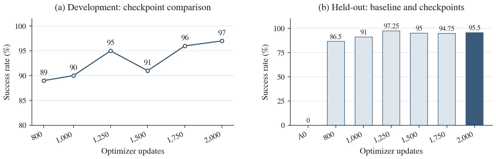
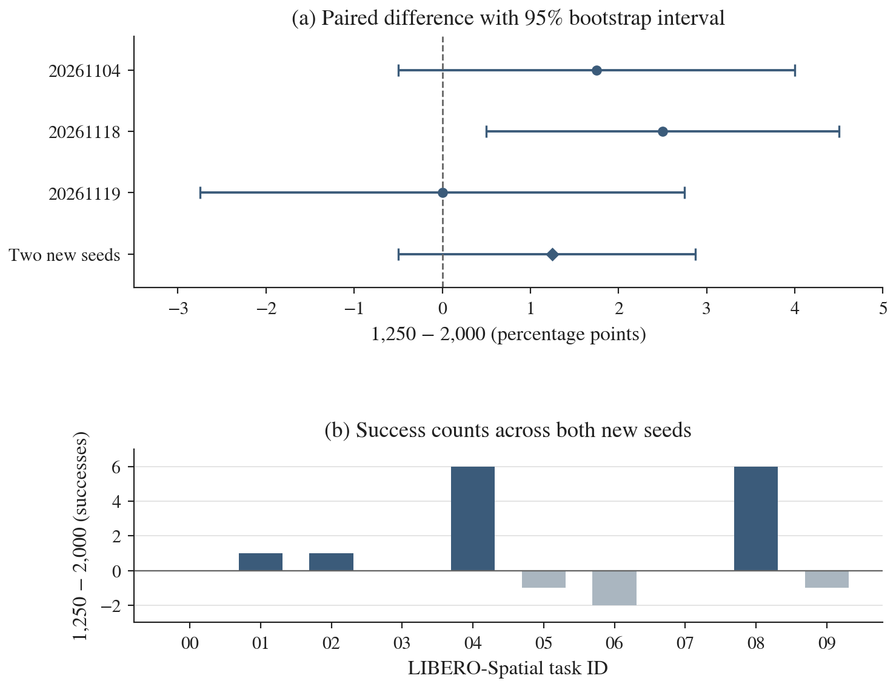

# π0.5 在 LIBERO 上的 LoRA 微调

单卡训练、配对评测与失败分析

[English](README.md) · [方法详解（英文）](docs/experiment.md) · [实验结果](#实验结果) · [对照录像](#失败分析) · [数据与复算](#可复现性) · [冻结版 v1.0.0](https://github.com/chaoshengsc/pi05-libero-finetuning/releases/tag/v1.0.0)

## 摘要

我们在单张 RTX A5000 上，将官方策略 `pi05_base` 通过全线性层 LoRA 训练 2,000 次参数更新。在 LIBERO-Spatial 的 400 个固定留出初态上，第 0 步基线 A0 成功 **0/400**，2,000 步成功 **382/400（95.50%）**。在首观测一致的 399 对中，十任务等权提升 **95.50 个百分点**（95% 配对区间 [93.50, 97.25]）。原推理种子下，1,250 步得分最高（389/400）。在两个新增推理种子下，1,250 相对 2,000 平均领先 1.25 个百分点（95% 区间 [−0.50, 2.875]）。2,000 步原来失败的 18 例中，16 例在至少一个新种子下成功。

## 实验设置

以「从抽屉里取黑碗并放到盘上」为例，策略根据场景图、腕部图和任务指令生成动作。我们实现了全线性层的 LoRA 映射、可恢复的单卡训练和同初态闭环评测。公开材料可以用来复算分数，也可以通过录像观察策略行为。


**图 1. 实验设计。**（a）一条训练样本由当前观测和接下来的 10 步示范动作构成。从第 0 步 A0 出发训出六个检查点。（b）原评测用固定初态配对比较，两个新增推理种子专项复测 1250 和 2000 步。[PDF](assets/experiment-design.pdf) · [SVG](assets/experiment-design.svg)

**表 1. 最终配置及选择依据。**

| 决策 | 实际设置 | 依据 |
|:--|:--|:--|
| 起点 | 官方 OpenPI `pi05_base`，LoRA 初始增量为零 | 第 0 步 A0 和训练检查点共用适配器结构与输入流程 |
| 微调 | 冻结底座，全线性层 LoRA，rank 64、alpha 32，分配 1.51 亿适配器参数 | 参考 Dream Machines 的 rank 64 配方，按本项目的 OpenPI 实现确定完整矩阵映射 |
| 示范数据 | 40 个任务，1,608 条训练、85 条离线验证 | 按整条示范切分，归一化只用训练数据拟合 |
| 优化 | 单张 RTX A5000，8 个样本 × 32 个微批，种子 0，峰值学习率 0.0005 | 用梯度累积在单卡上实现有效批量 256 |
| 训练长度 | 2,000 次更新，前 1,000 步预热，保留六个评测节点 | 实际预算在原 50,000 步调度的恒定阶段结束 |
| 闭环执行 | 预测 10 个动作，执行前 5 个再观察，最多 220 个动作步 | 按 LIBERO 原生任务条件计分 |

**先验收，再续训。** 652 步的早期开发验收得到 **77/100**。随后保留训练状态续训到 2000 步，800 步起的六个固定检查点进入正式比较。[参数来源、训练样本和续训过程](docs/experiment.md)

**表 2. 三个实验问题与对应比较。**

| 要回答的问题 | 比较对象 | 评测范围 |
|:--|:--|:--|
| 这次微调提升多少？ | A0 对 2000 步 | 原推理种子下每组 400 个留出初态，严格配对 399 对 |
| 哪个保存节点得分最高？ | 同一条训练轨迹的六个检查点 | 原种子下每个检查点 100 个开发初态、400 个留出初态 |
| 1250 步的领先对随机采样有多敏感？ | 1250 对 2000 步 | 同一批 400 个初态，各跑两个新增推理种子 |

开发集与留出集覆盖相同 10 个 LIBERO-Spatial 任务，仿真初态互斥。训练示范与评测初态的完整对应关系仍未核实。

## 实验结果



**图 2. 原推理种子 20261104 下的闭环成功率。**（a）六个训练检查点的开发成绩，每个 100 回合，纵轴从 80% 开始。（b）A0 与六个检查点的留出成绩，每组 400 回合，深色标记 2000 步训练终点，柱上标注成功率。[PDF](assets/evaluation-results.pdf) · [SVG](assets/evaluation-results.svg)

**表 3. 固定初态上的成功次数。** 加粗为各集合的最高观测成绩。A0 为官方策略在第 0 步的成绩，沿用相同的适配器结构、输入流程和由训练示范拟合的归一化。

| 检查点 | 开发集（n = 100） | 留出集（n = 400） |
|:--|--:|--:|
| A0 · 第 0 步 | 0 / 100 | 0 / 400 |
| 800 | 89 / 100 | 346 / 400 |
| 1,000 | 90 / 100 | 364 / 400 |
| 1,250 | 95 / 100 | **389 / 400** |
| 1,500 | 91 / 100 | 380 / 400 |
| 1,750 | 96 / 100 | 379 / 400 |
| 2,000 | **97 / 100** | 382 / 400 |

严格配对中，381 对仅在 2,000 步成功，18 对均失败。任务 01 初态 34 存在一项历史首观测差异，纳入该例后的全 400 对敏感性结果仍为 +95.50 个百分点。原留出评测中，2,000 步较 1,750 步高 0.75 个百分点（95% 区间 [−2.00, 3.50]）。[逐任务结果及配对统计](docs/results.md)

## 推理随机性

三个种子共用同一批 400 个留出初态。区间由任务内配对重采样得到。两个新增种子的结果仍不足以判定哪个检查点更好。



**图 3. 推理随机性。**（a）每个点为 1250 减 2000 步的成功率差，线段表示 95% 配对区间。菱形先按初态对两个新增种子取平均。（b）两个新种子合计，1250 步在任务 04 和 08 各多成功 6 次，其余八个任务合计少成功 2 次。[PDF](assets/inference-seed-comparison.pdf) · [SVG](assets/inference-seed-comparison.svg)

| 推理种子 | 1,250 步 | 2,000 步 | 差值（百分点） | 95% 配对区间（百分点） |
|:--|--:|--:|--:|--:|
| 20261104 | 389 / 400 | 382 / 400 | +1.75 | [−0.50, 4.00] |
| 20261118 | 395 / 400 | 385 / 400 | +2.50 | [0.50, 4.50] |
| 20261119 | 379 / 400 | 379 / 400 | 0.00 | [−2.75, 2.75] |

## 失败分析

原种子下，2,000 步的失败集中在抽屉取碗（11/40）、小烤碗上取碗（1/40）和盘旁取碗（6/40）。这 18 例中，11 例在两个新种子下都成功，5 例成功一次，2 例仍均失败。两个新种子也让 11 和 16 个原来成功的回合翻为失败，总成绩分别变化 +3 和 −3 回合。[18 例初态与逐例结果](docs/results.md#endpoint-failure-analysis)


**图 4. 任务 08，初态 12。** 2,000 步的夹爪在后侧容器附近操作，第 220 个动作步时目标碗仍在盘旁。1,250 步将目标碗放在盘上，第 179 步满足仿真器成功条件。两段录像共享首观测与推理种子，案例是在评测结束后选取的。

浏览器播放：[04/00 · 换种子成功取碗](https://cdn.jsdelivr.net/gh/chaoshengsc/pi05-libero-finetuning@70cf7dc0754567b5b425e05f74cc18f68f3f52f1/assets/failures/task04-00-comparison.mp4) · [04/45 · 三个种子均未完成](https://cdn.jsdelivr.net/gh/chaoshengsc/pi05-libero-finetuning@70cf7dc0754567b5b425e05f74cc18f68f3f52f1/assets/failures/task04-45-comparison.mp4) · [08/12 · 检查点对照](https://cdn.jsdelivr.net/gh/chaoshengsc/pi05-libero-finetuning@70cf7dc0754567b5b425e05f74cc18f68f3f52f1/assets/failures/task08-12-comparison.mp4)。[关键帧与图注](docs/demos.md#paired-failure-comparisons)

## 可复现性

11 月 18 日快照包含 **5,100 条计分回合**，其中 3,500 条使用原推理种子，1,600 条使用两个新种子。留出比较复用同一批 400 个初态。数据核验和配对统计仅依赖 Python 标准库。

```sh
git clone https://github.com/chaoshengsc/pi05-libero-finetuning.git
cd pi05-libero-finetuning
python scripts/analyze_results.py
python scripts/analyze_results.py --report
```

| 材料 | 位置 |
|:--|:--|
| 训练设置与数据划分 | [`configs/`](configs/) |
| 逐回合结果与任务统计 | [`results/`](results/README.md) |
| 录像与来源记录 | [`assets/demos/`](docs/demos.md) |
| 数据校验与绘图脚本 | [`scripts/`](scripts/) |
| 环境及复现命令 | [`docs/reproduce.md`](docs/reproduce.md) |

图表由核验后的记录生成，提供 PNG、SVG 和 PDF。当前版本支持复现已公开的数据分析，尚未分发模型权重及完整训练、评测启动程序。

## 局限性

结论限于一次训练、十个已知 LIBERO-Spatial 任务及仿真环境。1,250 步是检查原留出成绩后选出的对照对象。推理种子复测沿用同一批初态，区间只反映固定任务、权重和推理种子条件下的初态抽样。800 步留出评测跨越一次内核及显卡驱动更新，重启前完成 352 回合，恢复后补齐 48 回合。[实验与运行记录](docs/experiment.md#runtime-history)

## 基础项目

- [OpenPI](https://github.com/Physical-Intelligence/openpi) 提供预训练策略与模型实现。
- [LIBERO](https://github.com/Lifelong-Robot-Learning/LIBERO) 提供仿真任务与初态。
- [physical-intelligence/libero](https://huggingface.co/datasets/physical-intelligence/libero/tree/9dfa69510ea9e1613fc54112bc706444b686a231) 提供训练示范。

本仓库记录独立开展的微调实验。
