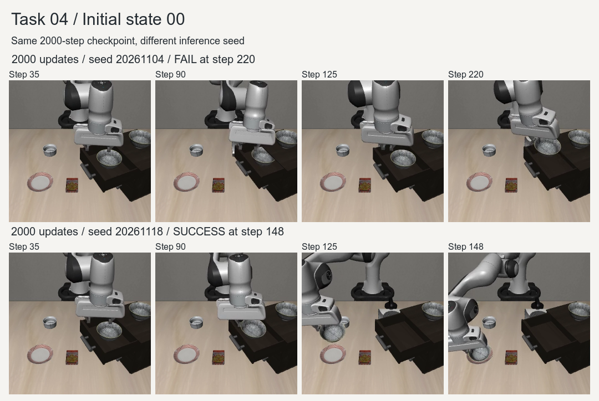
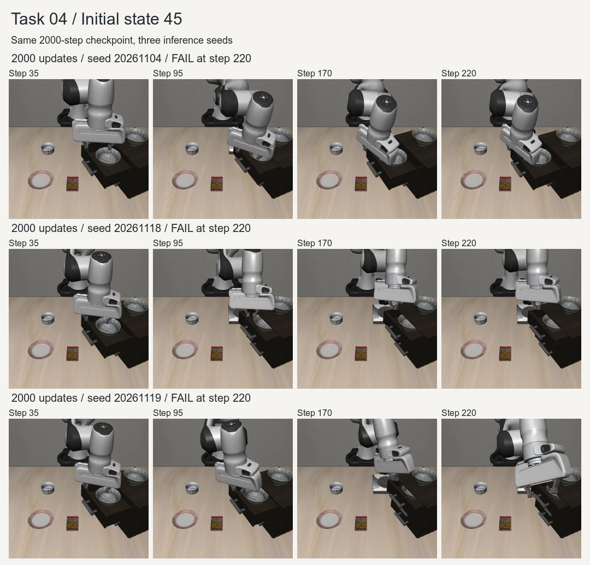
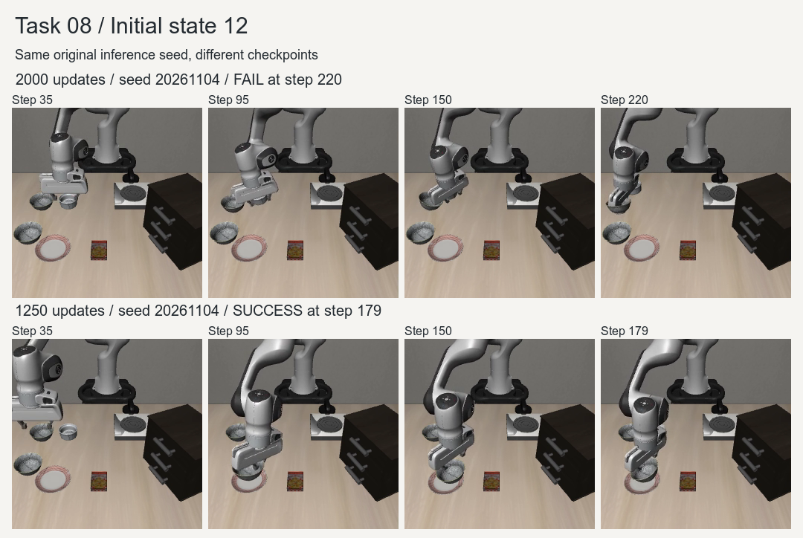
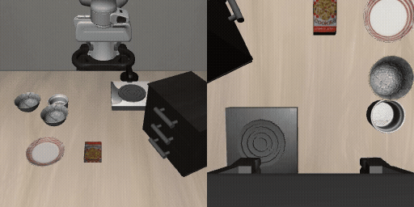
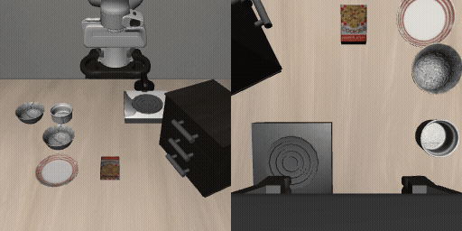
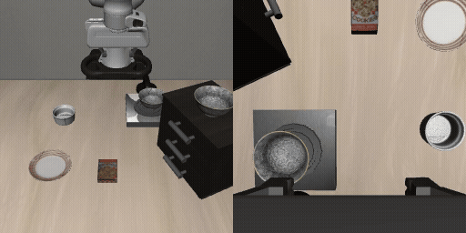

# Recorded policy episodes

[Project overview](../README.md) · [Episode data](../results/README.md) · [Comparison manifest](../assets/failures/manifest.json) · [Original demos manifest](../assets/demos/manifest.json)

These examples come from scored episodes on the held-out initial-state split.

## Paired failure comparisons

The three comparisons use the recorded external camera and are aligned by policy step at 20 Hz. A successful run ends at the first step at which the native task predicate is satisfied. Its last frame is held until the neighboring runs end. Every group has a matching first observation. The cases were selected after evaluation to illustrate observed behaviors. [Media labels and checksums](../assets/failures/manifest.json)

**Figure D1. Seed-dependent drawer retrieval (task 04, state 00).** Under seed 20261104, the arm is still at the drawer when the episode ends at step 220. Under seed 20261118 it carries the bowl over the plate by step 125 and meets the predicate at step 148. The second additional seed also succeeds (step 160). [Play in browser](https://cdn.jsdelivr.net/gh/chaoshengsc/pi05-libero-finetuning@70cf7dc0754567b5b425e05f74cc18f68f3f52f1/assets/failures/task04-00-comparison.mp4) · [Repository MP4](../assets/failures/task04-00-comparison.mp4)

**Figure D2. Repeated drawer failure (task 04, state 45).** The three 2,000-update rollouts reach the drawer and vary their gripper pose. All reach step 220 without delivering the bowl to the plate. At 1,250 updates two of the three seeds succeed on this state. [Play in browser](https://cdn.jsdelivr.net/gh/chaoshengsc/pi05-libero-finetuning@70cf7dc0754567b5b425e05f74cc18f68f3f52f1/assets/failures/task04-45-comparison.mp4) · [Repository MP4](../assets/failures/task04-45-comparison.mp4)

**Figure D3. Different checkpoint behavior at the same state (task 08, state 12).** Under the original seed, the 2,000-update policy works around the rear containers and leaves the target bowl beside the plate at the limit. The 1,250-update policy puts the target bowl on the plate and succeeds at step 179. At this state the respective counts are 0/3 and 3/3 across the evaluated seeds. [Play in browser](https://cdn.jsdelivr.net/gh/chaoshengsc/pi05-libero-finetuning@70cf7dc0754567b5b425e05f74cc18f68f3f52f1/assets/failures/task08-12-comparison.mp4) · [Repository MP4](../assets/failures/task08-12-comparison.mp4)

## Original 800-update recordings

These original clips show the external camera on the left and wrist camera on the right. GIF previews run at approximately original speed.

## Task 00 — between the plate and the ramekin

Instruction: “pick up the black bowl between the plate and the ramekin and place it on the plate”.

| Initial state | Recorded result | Policy steps | Original |
|:--|:--|--:|:--|
| 02 | Success | 78 | [MP4](../assets/demos/step800-task00-init02.mp4) |
| 16 | Unsolved at the step limit | 220 | [MP4](../assets/demos/step800-task00-init16.mp4) |

## Task 09 — on the wooden cabinet

Instruction: “pick up the black bowl on the wooden cabinet and place it on the plate”.

Initial state **00**, success in **131** policy steps. [Original MP4](../assets/demos/step800-task09-init00.mp4)

## Selection of the original recordings

For task 00, these are the first valid success and first valid failure in ascending initial-state order. For task 09, this is the first valid success by the same ordering. The selection rule was applied to existing recordings after evaluation.

The 800-update examples illustrate individual behaviors. Success labels come from the native task predicate in the final episode record.

The [manifest](../assets/demos/manifest.json) includes the checkpoint, task, initial state, outcome, step count and SHA-256 of each original recording.
