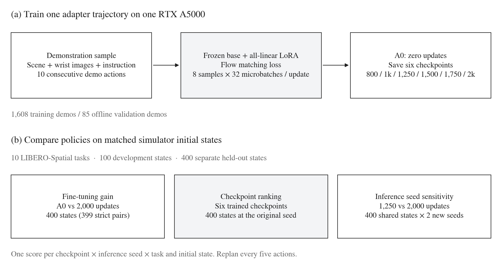

# Method and experiment protocol

[Project overview](../README.md) · [Results](results.md) · [Reproduce the analysis](reproduce.md)

## Research question

How much closed-loop task success can a single-GPU LoRA run obtain from the official pretrained `pi05_base` policy, and how does that behavior change along one training trajectory?

The unit of training progress is an **optimizer update**. The unit of evaluation is a **closed-loop episode** from a specified task and initial state. Each checkpoint is a snapshot of the same training run.

**Figure 1. Experimental design.** (a) The sample window, one accumulated update, and the saved checkpoints. (b) The matched baseline, the six-checkpoint ranking, and the inference-seed comparison. [PDF](../assets/experiment-design.pdf) · [SVG](../assets/experiment-design.svg)

## Design decisions

The goal was to obtain and measure a dual-camera LIBERO policy within a single RTX A5000 budget. The project implements the adapter mapping, episode-level data controls, accumulated training and checkpoint recovery, and the paired evaluation. It uses the OpenPI policy and LIBERO tasks as its starting point.

| Decision | Setting | Basis |
|:--|:--|:--|
| Adaptation | All-linear LoRA, rank 64, alpha 32 | The rank-64 arm in [Dream Machines](https://dream-machines.eu/blog/pi05-fine-tuning) informed the choice. The matrix mapping below is specific to the pinned OpenPI implementation. |
| Training scale | Effective batch 256 and peak LR 0.0005 | Reference values from the same arm. The project chose 8 samples per microbatch and 32-way accumulation for the A5000. |
| Learning objective and optimizer | π0.5 flow matching, AdamW and global norm clipping at 1.0 | Retained from the pinned OpenPI path, with gradient averaging and one clip per optimizer update. |
| Baseline construction | Random A with standard deviation 0.01, B initialized to zero | The project uses a zero initial weight increment so A0 shares the adapter architecture and input pipeline with the trained checkpoints. |
| Schedule and budget | 1,000-step warmup; original 50,000-step schedule; stop at 2,000 actual updates | The warmup length and exact endpoints are project settings. The final stop reflects the available runtime and delivery budget. |

These settings characterize the single observed training run. The experiment compares training stages under one recipe. Rank, augmentation and full fine-tuning remain outside the comparison.

## Data and separation

| Use | Contents | Purpose |
|:--|:--|:--|
| Training | 1,608 complete demonstrations from a 40-task dataset | Optimize adapters and fit normalization statistics |
| Offline validation | 85 complete demonstrations from the same dataset | Offline action-prediction diagnostics |
| Development | 10 LIBERO-Spatial tasks × 10 fixed initial states | Inspect and compare the training trajectory |
| Held-out | The same 10 tasks × 40 other fixed initial states | Evaluate the six-checkpoint comparison |

The dataset contains 1,693 demonstrations in total. Training and offline validation are separated by whole demonstration; the [original demonstration split](../configs/demonstration_split.json) lists episode IDs and allocation across all 40 tasks. Evaluation splits partition each task's 50 simulator initial states. Demonstration records and simulator initial-state IDs are different objects.

Initial states are partitioned by a deterministic hash-based rule, with task 0 / initial state 0 reserved for development. Held-out states are disjoint from development and cover the same tasks. The full mapping from training demonstrations to evaluation initial states remains unverified. [Partition rule and state lists](../configs/evaluation.json)

## A training example

Consider a demonstration of picking up the black bowl from the drawer and placing it on a plate. At frame `i`, take the scene image, wrist image, and instruction. The target is the ten demonstration actions starting at frame `i`. Near the end of the trajectory, repeat its final action to fill the window. Use the training-derived quantile statistics for normalization and pad the seven control channels to the model's 32-channel action space.

| Unit | Contents | Role |
|:--|:--|:--|
| Demonstration | One entire recorded trajectory | Assigned in full to training or offline validation |
| Training sample | One frame's observations and a 10-action target window | Supplies a supervised flow matching target |
| Optimizer update | 8 samples × 32 microbatches | Average the accumulated FP32 adapter gradients, clip globally, then apply AdamW once |
| Evaluation episode | One policy-controlled task from a fixed initial state | Execute actions in the simulator and count native task success |

At sampled flow time $t$, the action expert receives $x_t=t\epsilon+(1-t)a$ and predicts the velocity target $\epsilon-a$, where $a$ is the action window and $\epsilon$ is Gaussian noise. The training objective averages squared error over the 32 action channels, action positions and samples. Gradients update the adapters. The main trajectory totals **2,000 × 256 = 512,000 sample presentations**, including repeated sample IDs.

## Recorded training configuration

| Setting | Value |
|:--|:--|
| Starting policy | Official OpenPI `pi05_base` |
| Adaptation | All target linear layers, LoRA rank 64 / alpha 32 |
| Base parameters | Frozen |
| Adapter elements | 151,250,944 across 456 logical matrices |
| Precision | BF16 base, FP32 adapters / gradients / Adam state |
| Hardware | One NVIDIA RTX A5000 |
| Microbatch / accumulation | 8 × 32 = 256 examples per optimizer update |
| Training seed | 0 |
| Peak learning rate | 5 × 10⁻⁴ |
| Learning-rate warmup | 1,000 updates |
| Optimizer | AdamW, β₁ 0.9 / β₂ 0.95, ε 10⁻⁸, weight decay 10⁻¹⁰ |
| Gradient clipping | Global norm 1.0 |
| Image augmentation / LoRA dropout | Disabled / 0 |
| Completed training budget | 2,000 optimizer updates |
| Retained checkpoints | 800, 1,000, 1,250, 1,500, 1,750, 2,000 |

The run retains the original learning-rate schedule: warmup to 1,000 updates, stable phase until 40,000, and decay to the original 50,000-update horizon. The actual run ends at 2,000; the schedule was not rescaled to this shorter budget. [Machine-readable settings](../configs/training.json)

### Adapter coverage

Each target matrix of size $d_{in}\times d_{out}$ is adapted with two factors containing $64(d_{in}+d_{out})$ scalars. The forward increment is $(32/64)AB$. Attention Q, K, V and output matrices have separate factors over their full projection axes, with independent factors per layer. The base kernels, biases, input embeddings, normalization parameters and patch convolution stay frozen. The adaptive normalization conditioning projections are among the linear targets.

| Component | Logical matrices | Adapter scalars |
|:--|--:|--:|
| Language backbone attention and MLP | 126 | 78,446,592 |
| Action expert attention and MLP | 126 | 27,721,728 |
| Action expert conditioning projections | 37 | 9,699,328 |
| Vision tower and output projection | 163 | 34,985,984 |
| Action input and output projections | 2 | 135,168 |
| Time MLP | 2 | 262,144 |
| **Total allocated** | **456** | **151,250,944** |

The total counts allocated adapter scalars. Of these, 4,063,232 belong to five matrices in the final language layer (Q, O, gate, up and down) that have no gradient path from the action loss. The 32-channel action projections allocate rank-64 factors, with effective matrix rank bounded by 32.

## From the original plan to the completed run

This chronology is drawn from the training archive. The published score tables cover A0 and the six retained evaluation checkpoints.

| Stage | Decision and evidence |
|:--|:--|
| Initial plan | Longer-budget checkpoints were envisioned under a 50,000-update schedule. Data, base-weight identity, adapter behavior, resource headroom and save/restore were checked in small runs before training. |
| Early checkpoint | The time-budgeted pilot obtained 77/100 at step 652 on development states. This early check sits outside the six-checkpoint held-out ranking. |
| Checkpoint recovery | The run continued from saved training state, including parameters, optimizer, sampler and random state. At the planned 800-step cutover, the first resumed update was 801. |
| Completed trajectory | Training reached 2,000 updates. The retained nodes are 800, 1,000, 1,250, 1,500, 1,750 and 2,000. The actual run covers warmup and part of the constant-rate phase, before the original decay point. |
| Matched evaluation | Compare A0 with the endpoint, evaluate all six trained checkpoints on the same 400 states, then use two additional inference seeds to revisit the observed high point at 1,250 versus 2,000. |

## Closed-loop inference

Each query conditions the policy on camera images and the task instruction. The state array remains in the model interface, but this run disables discrete state tokenization and the π0.5 action expert does not use a continuous state token. The loop renders 256 × 256 observations, applies the recorded 180° orientation transform and 224 × 224 resize, samples an action chunk, executes part of it, then observes again.

| Setting | Value |
|:--|:--|
| Environment seed | 0 |
| Simulator control rate | 20 Hz |
| Settling steps | 10 before policy control |
| Action chunk | 10 steps |
| Actions executed before replanning | 5 steps |
| Policy action representation | 32 padded channels, 7 robot action dimensions |
| Flow sampling steps | 10 |
| Episode limit | 220 policy-controlled steps |
| Scored repeats | 1 per initial state, checkpoint, and inference seed |

The flow policy's sampling noise is deterministic per task, initial state, repeat, and query index. All original checkpoint groups and the matched baseline use inference seed 20261104. The sensitivity evaluation changes this seed to 20261118 and 20261119 for 1,250 and 2,000 updates, leaving the environment seed and remaining inference settings fixed. Each episode executes the policy directly.

A successful episode satisfies LIBERO's native Boolean task predicate. An unsolved episode at the 220-step limit is a policy failure. An infrastructure error may receive one exact retry on the same initial state; a still-unresolved technical episode blocks a complete score. The public data includes final valid outcomes, not all attempts.

## Checkpoint comparison

| Question | Comparison | Scored initial states |
|:--|:--|:--|
| How much did fine-tuning help? | A0 vs 2,000 at the original inference seed | 400 per policy; 399 matched first observations in the strict analysis |
| Which saved step scored highest? | Six trained checkpoints at the original inference seed | 100 development and 400 held-out per checkpoint |
| How sensitive is the observed lead to inference sampling? | 1,250 vs 2,000 at two additional seeds | 400 per checkpoint and seed |

All six checkpoints use the same 100 development task/state pairs and the same 400 held-out pairs. The reported success rate equals both the mean of the ten task success rates and the fraction of successful episodes because each task contributes equally.

The full six-checkpoint held-out comparison was fixed before those scores were used to select a winner. The final ranking is still a comparison over six candidates on one held-out sample; it is not an independent confirmation of the post-hoc top-ranked checkpoint.

The matched baseline restores the original frozen step-zero checkpoint with zero optimizer updates, then runs all 400 held-out states. This comparison tests the training endpoint, 2,000 updates, with the same adapter structure and training-derived normalization. Task 01/state 34 has a recorded first-observation mismatch at the original 2,000-update checkpoint. The results report both the strict 399-pair comparison and the all-state comparison for A0 vs 2,000 and for 1,750 vs 2,000. [Observation exceptions and retry](results.md#observation-exceptions)

Paired bootstrap intervals resample `(task_id, initial_state_id)` within each fixed task and average task differences equally. The 10,000 draws use analysis seeds 20261104 for 1,750 vs 2,000, 20261118 for A0 vs 2,000, and 20261117 for inference-seed comparisons. For the two-seed average, both observations from each initial state stay together. [Full paired results](results.md)

## Version pins

| Component | Revision |
|:--|:--|
| OpenPI | [`215abfb217db`](https://github.com/Physical-Intelligence/openpi/commit/215abfb217dbac7d5f1273282331b9b1866c0479) |
| LIBERO | [`8f1084e3132a`](https://github.com/Lifelong-Robot-Learning/LIBERO/commit/8f1084e3132a39270c3a13ebe37270a43ece2a01) |
| Demonstrations | [`physical-intelligence/libero@9dfa69510ea9`](https://huggingface.co/datasets/physical-intelligence/libero/tree/9dfa69510ea9e1613fc54112bc706444b686a231) |
| JAX / jaxlib | 0.5.3 |
| Flax / Optax | 0.10.2 / 0.2.4 |
| NumPy / Orbax Checkpoint | 1.26.4 / 0.11.13 |

Original evaluation protocol SHA-256:
`7039fd18b555a239fc5505c50ff26468a246d61d78aef18fe77aef7e1b190e70`

The public configuration is a projection of the original protocol and the later six-checkpoint comparison decision. This hash identifies the original protocol bytes, not the public JSON file.

## Runtime history

The 800-update held-out run contains 352 episodes completed before a workstation restart and 48 completed afterward with an updated Linux kernel and NVIDIA driver. The two evaluator logs assign every scored task/state pair to one of these batches. The respective counts are 312/352 and 34/48. The batches cover different states, so their rates describe the batches and cannot isolate the effect of the runtime update. [Episode-to-batch mapping](../results/step800_runtime.csv)

Before the restart, the environment used Linux 6.11.0-26 and NVIDIA driver 570.133.07. Afterward it used Linux 7.0.0-43 and NVIDIA driver 580.178.04. This runtime change is a reproducibility limitation. A fixed initial state and seed do not establish bitwise equivalence across different numerical runtimes.

## What is published

The repository contains completed episode outcomes, task-level aggregates, training/evaluation records, selected original videos and analysis code. The full training wrapper, model checkpoints, and unabridged execution logs are not part of this release. [Reproduction scope →](reproduce.md)
