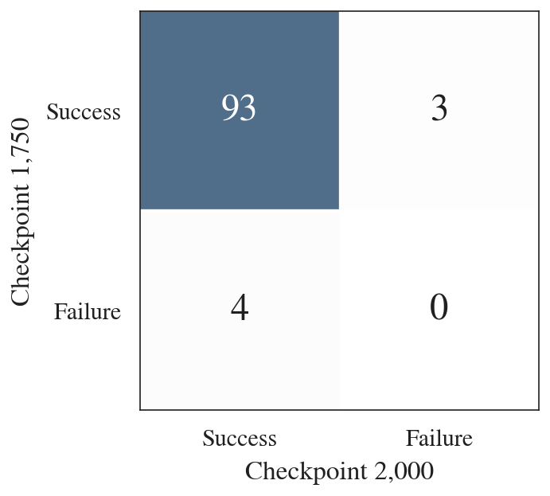

# Supplementary results

[Overview](../README.md) · [Protocol](experiment.md) · [Data](../results/README.md)

## Per-task development results

Development success increases overall from 89/100 at 800 updates to 97/100 at 2,000, with a decrease at 1,500. Figure S1 reports all task-level counts.


**Figure S1. Per-task development evaluation.** Each cell reports successes out of the same ten development initial states for that task. Color encodes the count on a scale from 0 to 10. All tasks require placing the black bowl on the plate; labels describe its starting location. [PDF](../assets/task-checkpoint-matrix.pdf) · [SVG](../assets/task-checkpoint-matrix.svg)

These observations do not identify the cause of a task-level regression. The pretrained baseline, 0/100, is a measurement under this project's input, normalization and evaluation protocol rather than a universal claim about `pi05_base`.

## Paired checkpoint comparison



**Figure S2. Paired development outcomes.** Rows correspond to checkpoint 1,750 and columns to checkpoint 2,000. Each entry counts identical task–initial-state pairs (n = 100). [PDF](../assets/paired-development.pdf) · [SVG](../assets/paired-development.svg)

| Checkpoint 1,750 | 2,000 succeeds | 2,000 fails |
|:--|--:|--:|
| Success | 93 | 3 |
| Failure | 4 | 0 |

Four initial states improve and three regress, yielding a net difference of +1 percentage point for 2,000. This descriptive comparison uses development data inspected across checkpoints and does not establish a held-out advantage.

```sh
python scripts/analyze_results.py --pair 1750 2000 --split development
```

## Held-out results at checkpoint 800


**Figure S3. Held-out evaluation at 800 updates.** Each task contributes 40 episodes. Bar labels give success counts; the dashed line indicates 346/400 = 86.5% overall success. [PDF](../assets/held-out-tasks.pdf) · [SVG](../assets/held-out-tasks.svg)

Task-level outcomes range from 27/40 to 40/40. Selected videos illustrate a success and a failure for task 00; their labels come from the recorded native simulator predicate. A failure cause is not assigned from these examples alone.

## Complete held-out results

Each cell gives successes out of 40 initial states under inference seed 20261104. A0 has zero successes for each task, using the same inference stack and normalization as the trained policies.

| Task | A0 | 800 | 1,000 | 1,250 | 1,500 | 1,750 | 2,000 |
|:--|--:|--:|--:|--:|--:|--:|--:|
| 00 | 0 | 35 | 40 | 40 | 40 | 39 | 40 |
| 01 | 0 | 37 | 35 | 40 | 38 | 40 | 40 |
| 02 | 0 | 40 | 40 | 40 | 40 | 40 | 40 |
| 03 | 0 | 39 | 38 | 39 | 39 | 40 | 40 |
| 04 | 0 | 32 | 31 | 36 | 36 | 36 | 29 |
| 05 | 0 | 30 | 33 | 37 | 39 | 33 | 39 |
| 06 | 0 | 37 | 37 | 40 | 40 | 39 | 40 |
| 07 | 0 | 35 | 39 | 38 | 40 | 40 | 40 |
| 08 | 0 | 34 | 34 | 39 | 40 | 37 | 34 |
| 09 | 0 | 27 | 37 | 40 | 28 | 35 | 40 |
| **Total / 400** | **0** | **346** | **364** | **389** | **380** | **379** | **382** |

The primary baseline comparison uses the fixed training endpoint at 2,000 updates. The original A0 development group and the completed matched A0 held-out group are published here. The 400-state A0 evaluation completed with no technical failures.

| Left → right | Pairs | Both succeed | Left only | Right only | Both fail | Task-mean difference (pp) | 95% interval (pp) |
|:--|--:|--:|--:|--:|--:|--:|--:|
| A0 → 2,000, strict | 399 | 0 | 0 | 381 | 18 | +95.50 | [93.50, 97.25] |
| A0 → 2,000, all states | 400 | 0 | 0 | 382 | 18 | +95.50 | [93.50, 97.25] |
| 1,750 → 2,000 | 400 | 364 | 15 | 18 | 3 | +0.75 | [−2.00, 3.50] |

The strict A0 comparison excludes task 01, state 34 because the original 2,000-update run recorded a different first observation. Each task still has equal weight with 39 pairs for task 01 and 40 elsewhere. The all-state row shows sensitivity to including this pair. The 1,750 → 2,000 row reports the original matched-initial-state analysis.

## Inference seed sensitivity

Two additional inference seeds evaluate 1,250 and 2,000 on the same 400 states. The 1,250 candidate was chosen after the original held-out comparison. Across the 1,600 additional scored episodes, 80 are reused from a pilot and 1,520 are newly evaluated.

| Seed | 1,250 | 2,000 | Both succeed | 1,250 only | 2,000 only | Both fail | 1,250 − 2,000 (pp) | 95% interval (pp) |
|:--|--:|--:|--:|--:|--:|--:|--:|--:|
| 20261104 | 389 | 382 | 374 | 15 | 8 | 3 | +1.75 | [−0.50, 4.00] |
| 20261118 | 395 | 385 | 381 | 14 | 4 | 1 | +2.50 | [0.50, 4.50] |
| 20261119 | 379 | 379 | 362 | 17 | 17 | 4 | 0.00 | [−2.75, 2.75] |

For the two additional seeds, the mean difference is +1.25 pp [−0.50, 2.875]. Each initial state's two outcomes are averaged before resampling. This interval conditions on the two tested seeds and reflects variation across initial states within the fixed tasks. The original seed row is the historical 400-state comparison. Its task 01/state 34 mismatch is documented above. Both variants succeed on that state under all three seeds, so it contributes no flip or checkpoint difference.

## Endpoint failure analysis

At 2,000 updates, 18 episodes under the original seed reach the 220-step limit without satisfying the native success predicate. All three seed runs match on the first observation for these 18 cases. State IDs below are local to each task.

| Task | Original failures / 40 | Both new seeds succeed | 20261118 only | 20261119 only | All three fail |
|:--|--:|:--|:--|:--|:--|
| 04 Inside top drawer | 11 | 00, 18, 20, 39, 44, 48 | 05, 23 | 04, 30 | **45** |
| 05 On ramekin | 1 | 22 | — | — | — |
| 08 Next to plate | 6 | 29, 32, 41, 46 | 47 | — | **12** |
| **Total** | **18** | **11** | **3** | **2** | **2** |

Across all 400 initial states, seed 20261118 changes 14 failures to successes and 11 successes to failures (385/400). Seed 20261119 changes 13 failures to successes and 16 successes to failures (379/400). These counts include the original 18 failures and the reverse changes among the original 382 successes.

The recordings show examples of prolonged manipulation around the drawer, successful removal after changing the inference seed, and different object approaches across checkpoints. They support behavioral descriptions at these initial states. Contact forces and the causes of checkpoint differences remain unmeasured. [Three paired comparisons](demos.md#paired-failure-comparisons)

## Statistical scope

Intervals are percentile estimates from 10,000 paired bootstrap draws, resampling initial states within tasks and averaging task differences equally. Results characterize this training run and the fixed evaluation tasks. The six-checkpoint ranking and the selected recordings are descriptive. [Protocol](experiment.md#checkpoint-comparison) · [Episode data and provenance](../results/README.md)
