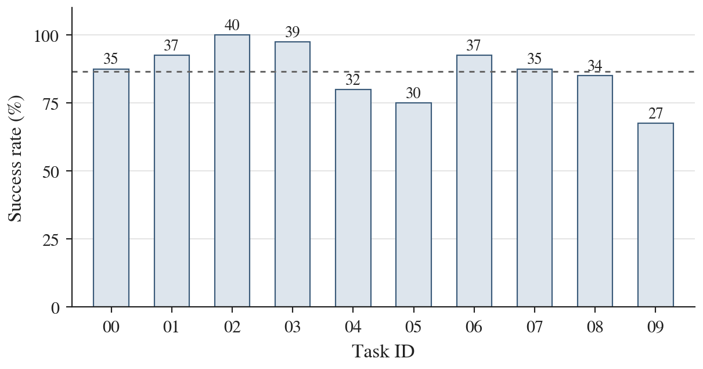

# Supplementary results

[Overview](../README.md) · [Protocol](experiment.md) · [Data](../results/README.md)

## Per-task development results

Development success increases overall from 89/100 at 800 updates to 97/100 at 2,000, with a decrease at 1,500. Figure S1 reports all task-level counts.


**Figure S1. Per-task development evaluation.** Each cell reports successes out of the same ten development initial states for that task. Color encodes the count on a scale from 0 to 10. All tasks require placing the black bowl on the plate; labels describe its starting location. [PDF](../assets/task-checkpoint-matrix.pdf) · [SVG](../assets/task-checkpoint-matrix.svg)

These observations do not identify the cause of a task-level regression. The pretrained baseline, 0/100, is a measurement under this project's input, normalization and evaluation protocol rather than a universal claim about `pi05_base`.

## Paired checkpoint comparison


**Figure S2. Paired development outcomes.** Rows correspond to checkpoint 1,750 and columns to checkpoint 2,000. Each entry counts identical task–initial-state pairs (n = 100). [PDF](../assets/paired-development.pdf) · [SVG](../assets/paired-development.svg)

| Checkpoint 1,750 | 2,000 succeeds | 2,000 fails |
|:--|--:|--:|
| Success | 93 | 3 |
| Failure | 4 | 0 |

Four initial states improve and three regress, yielding a net difference of +1 percentage point for 2,000. This descriptive comparison uses development data inspected across checkpoints and does not establish a held-out advantage.

```sh
python scripts/analyze_results.py --pair 1750 2000 --split development
```

## Held-out results at checkpoint 800



**Figure S3. Held-out evaluation at 800 updates.** Each task contributes 40 episodes. Bar labels give success counts; the dashed line indicates 346/400 = 86.5% overall success. [PDF](../assets/held-out-tasks.pdf) · [SVG](../assets/held-out-tasks.svg)

Task-level outcomes range from 27/40 to 40/40. Selected videos illustrate a success and a failure for task 00; their labels come from the recorded native simulator predicate. A failure cause is not assigned from these examples alone.

## Pending analyses and limitations

| Analysis | Required evidence |
|:--|:--|
| Six-checkpoint held-out ranking | Six complete groups of 400 episodes |
| Held-out 1,750 / 2,000 comparison | Paired outcomes, task breakdown and uncertainty estimate |
| Variation across training seeds | Additional independent training runs |
| Unseen-task or real-robot performance | Separate evaluation protocols |

This release does not report cross-seed uncertainty, unseen-task performance, or real-robot validation. A future best-of-six ranking will describe the fixed held-out sample and is subject to selection uncertainty.

The snapshot was exported at **2026-11-16 13:56 CST**. The [episode CSV](../results/episodes.csv) contains 100 pretrained-baseline development episodes, 600 trained development episodes, and 400 held-out episodes. [Provenance](../results/provenance.json) records source digests and the runtime-change note.
