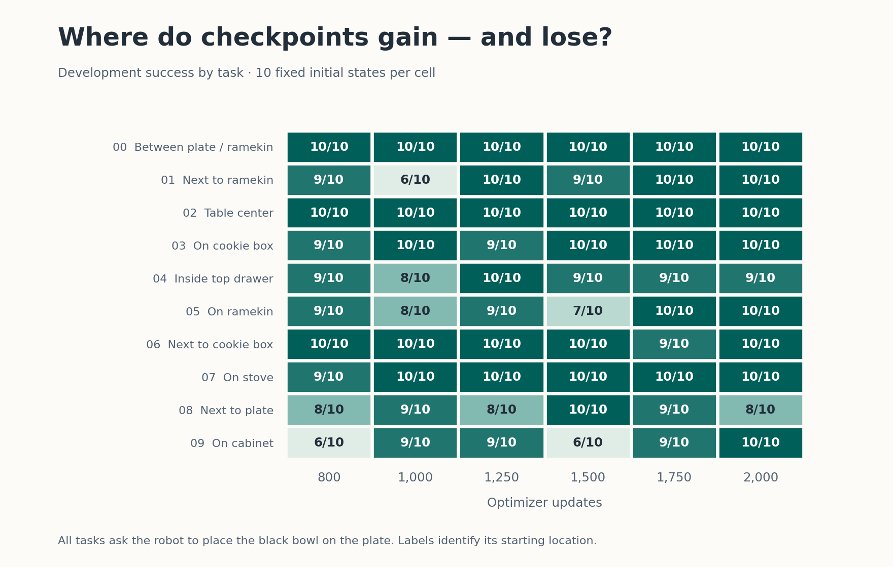

# Reading the results

[Project overview](../README.md) · [Protocol](experiment.md) · [Data](../results/README.md)

## What is already measured

- Training reached 2,000 optimizer updates with six retained checkpoints.
- All six development evaluations are complete, using 100 shared initial states each.
- The 800-update checkpoint completed 400 held-out episodes with 346 successes.
- The official pretrained starting policy scored 0/100 under this project's development protocol.

The baseline is a local measurement with this data normalization, input pipeline, and task protocol. It is not a universal claim about `pi05_base` or an official benchmark score.

## The trajectory is not monotonic

Development success increases overall from 89/100 at 800 updates to 97/100 at 2,000, with a decrease at 1,500. The task matrix shows which tasks contribute to those changes.



These checkpoint observations alone do not identify why a task regressed. A causal claim would require a controlled intervention or additional experimental evidence.

## A one-point gain contains seven disagreements

On development, the paired 1,750 / 2,000 outcomes are:

| 1,750 result | 2,000 success | 2,000 failure |
|:--|--:|--:|
| Success | 93 | 3 |
| Failure | 4 | 0 |

Four initial states improve and three regress. The net difference is +1 percentage point for 2,000. This is a descriptive comparison on a development set inspected across checkpoints; it does not establish that 2,000 generalizes better.

Reproduce the exact counts:

```sh
python scripts/analyze_results.py --pair 1750 2000 --split development
```

## The first held-out result

At 800 updates, 346 of 400 episodes succeed. Each task contributes 40 outcomes. Task 02 reaches 40/40, while task 09 reaches 27/40. The overall 86.5% does not mean that each task is equally reliable.


The selected videos illustrate both a success and a failure for task 00. Their labels come from the recorded simulator predicate. We do not assign a failure cause from the video alone.

## What remains open

| Question | Evidence needed |
|:--|:--|
| Which checkpoint has the highest held-out score? | All six complete 400-episode groups |
| How do 1,750 and 2,000 differ on the same held-out states? | Paired outcomes, task breakdown and uncertainty estimate |
| How stable are these results across training randomness? | Additional training seeds |
| Do improvements transfer to new task families or a real robot? | Separate evaluation protocols and data |

This release does not report cross-seed uncertainty, performance on unseen tasks, or real-robot validation. The six-checkpoint ranking will describe the fixed held-out sample; choosing the best score introduces selection uncertainty.

## Snapshot and evidence

The public snapshot was exported at **2026-11-16 13:56 CST**. Partial groups are excluded. The [episode CSV](../results/episodes.csv) contains 1,100 rows: 100 pretrained-baseline episodes, 600 trained development episodes, and 400 held-out episodes. [Provenance](../results/provenance.json) records source digests and the runtime-change note.
